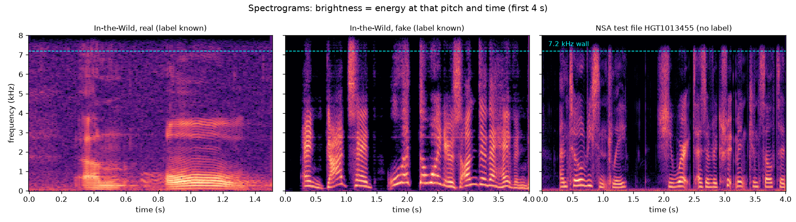
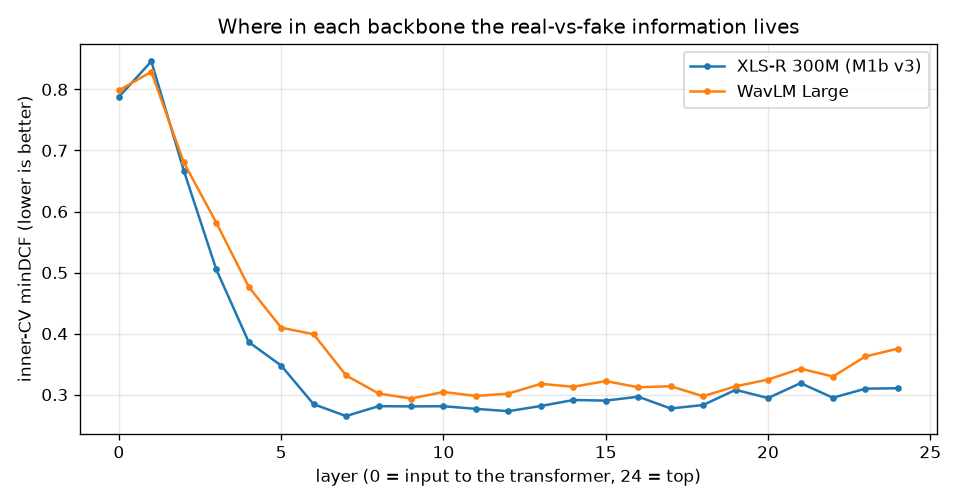
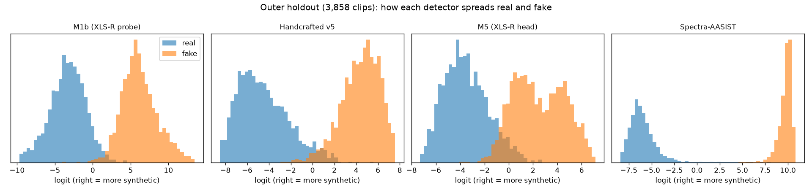

# HEARSAY v1, explained from zero

A learning guide to the system we submitted (git tag `v1`). It assumes no background in audio or machine learning.

- **Lessons build on each other.** Read them in order.
- **Each lesson ends with check-yourself questions.** Answers are hidden under "Answer"; try first.
- **Each lesson says where to go deeper:** the report or code behind it.

Every number comes from the repo, and the file is named. Where something is general knowledge rather than something we measured, it says **background**.

The three figures were made by `uv run --with matplotlib python scripts/learn_figures.py` from our own data.

The master plan for what comes next is [`docs/prod-chunks.md`](../prod-chunks.md). This guide is its chunk V2-0U.

## Contents

0. [What to say when someone asks](#0-what-to-say-when-someone-asks)
1. [The task and how it was scored](#1-the-task-and-how-it-was-scored)
2. [Audio in five minutes](#2-audio-in-five-minutes)
3. [How fake voices are made](#3-how-fake-voices-are-made)
4. [Data, folds and why "held out" matters](#4-data-folds-and-why-held-out-matters)
5. [Shortcuts: the traps we found](#5-shortcuts-the-traps-we-found)
6. [Deep detector 1: the frozen XLS-R probe (M1 / M1b)](#6-deep-detector-1-the-frozen-xls-r-probe-m1--m1b)
7. [Deep detector 2: M5, the trained head](#7-deep-detector-2-m5-the-trained-head)
8. [Deep detector 3: Spectra-AASIST (M3)](#8-deep-detector-3-spectra-aasist-m3)
9. [The handcrafted detector](#9-the-handcrafted-detector)
10. [The forensic detectors](#10-the-forensic-detectors)
11. [Fusion: turning four opinions into one number](#11-fusion-turning-four-opinions-into-one-number)
12. [One file, end to end](#12-one-file-end-to-end)
13. [What v1 is bad at](#13-what-v1-is-bad-at)
14. [Hands-on exercises](#14-hands-on-exercises)
15. [Glossary](#15-glossary)

---

## 0. What to say when someone asks

**Ten seconds.** "HEARSAY takes any audio clip and says how likely it is that the voice is AI-generated, and why. On NSA's hidden test set it scored a minDCF of 0.073, an equal error rate of 3.5%."

**One minute.**
- **What happens to a clip.** Every clip is converted to the same format: 16 kHz mono, low-passed to match the test set. Then about ten detectors look at it.
- **Three detectors make the decision.** All three are built on XLS-R, a large speech model pretrained by Meta:
  - a simple classifier reading one of its middle layers
  - a small trained network on top of it
  - an off-the-shelf anti-spoofing model, Spectra-AASIST, which we allow only to *lower* a score, never raise it
- **A fourth model adds a second, independent view.** It is a tree model over 234 hand-designed spectral and prosody measurements.
- **The rest only explain.** Detectors for compression, mains hum, splices and speaker consistency are printed in the explanation but never change the score. On our data they measured *where the recording came from*, not whether it was fake.
- **How the scores combine.** We blend the detector scores by rank with fixed weights (60/20/20) that we pre-declared before looking at results.
- **The most important engineering.** Finding and removing five ways the training data differed from the test data that a model could cheat on.

**The honest weak spots, if asked.**
- **Background noise.** At 20 dB of white noise, our fused score turns most fakes into misses.
- **Real-world audio.** Our scores on real-world audio (In-the-Wild) are about 3× worse than on NSA's test.

Sources: `submissions/log.csv`, `docs/reports/2026-09-26_channel-robustness.md`.

---

## 1. The task and how it was scored

**The task.** NSA gave us 1,671 audio files with no labels and asked for one number per file: the probability that the voice is synthetic. 1.0 means synthetic, 0.0 real. About 70% of the files are real (`docs/nsa-challenge.md`).

**The score: minDCF.** NSA grades with a *detection cost function*. Two kinds of mistake are possible:
- **False alarm (FA):** a real voice called fake.
- **Miss:** a fake voice called real.

NSA's rules say a false alarm costs **4×** a miss. Real files are also 70% of the set vs 30% fake. Put together, our normalized cost works out to:

> **cost = 9.33 × (false-alarm rate) + (miss rate)**

So one percentage point of false alarms costs as much as 9.33 points of misses. **The whole system is tuned to protect real voices.** Most design decisions in v1 follow from that one sentence.

The **"min"** in minDCF means the grader tries every possible threshold on our scores and keeps the best one. So only the **order** of our scores matters, not their exact values. If every fake file scores higher than every real file, we get a perfect 0, whatever the actual numbers are.

**EER (equal error rate)** is a second, simpler number: the error rate at the threshold where false alarms equal misses. Ours was 3.5%.

**Points.** 60% of the grade was minDCF, scored as (1 − ours)/(1 − best) × 60. One team scored 0.058 to our 0.073, which cost us about 0.95 points (`docs/STATUS.md`). The other 40% was technique diversity and documentation.

**A twist.** NSA's own scoring code treated a *higher* score as *real*, the opposite of their written instructions. We followed the instructions, prepared a flipped file just in case, and NSA's draft-review result (EER 3.5%, not 96.5%) confirmed our direction (`docs/reports/2026-09-26_draft-review-branches.md`).

<details><summary>Check yourself</summary>

1. Why can't we just output 0.5 for files we're unsure about and be safe?
2. If we multiplied every score by 0.5, would minDCF change?
3. Why does the system care more about real voices than fake ones?

**Answers.**
1. A middle score still lands *somewhere* in the ranking, and where it lands relative to the threshold decides whether it's a false alarm. v1 puts "can't judge" files at the very bottom (most-real end) on purpose (lesson 11).
2. No. The order is unchanged, and minDCF only depends on order.
3. A false alarm costs 9.33× a miss, after combining the 4× cost with the 70/30 class split.
</details>

---

## 2. Audio in five minutes

**A waveform** is a list of numbers: the microphone's air-pressure reading taken many times a second. **16 kHz** means 16,000 readings per second, so our 3.4-second median test clip is about 54,000 numbers.

**Highest frequency.** A recording at sample rate *R* can only hold sounds up to *R*/2. At 16 kHz that is 8 kHz (the *Nyquist* limit). Speech lives mostly below 4 kHz; the 4–8 kHz range holds hiss, "s" and "f" sounds, and many synthesis artifacts.

**A spectrogram** turns a waveform into a picture:
- **Axes.** Time runs left to right and frequency runs bottom to top.
- **Brightness.** How much energy there is at that frequency at that moment.
- **Stripes.** The horizontal stripes in voiced sounds are *harmonics*: multiples of the voice's pitch.



What to notice:
- **Left (real, In-the-Wild).** A real recording from the internet: background noise fills the whole picture, even between words.
- **Middle (fake, In-the-Wild).** Between words it is pure black: digital silence. That is typical of TTS. It is also typical of a clean studio, so it is a hint, not proof.
- **Right (an NSA test file).** Above the dashed line at **7.2 kHz** there is almost nothing. 1,602 of the 1,671 test files have this "wall" (a 44 dB drop), and **none of our training data does**. Lesson 5 explains why that mattered enormously.

**Codecs** (MP3, AAC, Opus, phone codecs) shrink audio by throwing away what the ear won't miss. They leave traces: cut-off high frequencies, "holes" in the spectrum, a different noise floor. Those traces describe the file's *history*, not the voice.

**Mono vs stereo, file formats.** v1 decodes everything through one FFmpeg path to 16 kHz mono floating-point (`hearsay.audio.load_audio`). After that, no detector ever sees the original format, sample rate or filename (`docs/architecture.md` §4).

<details><summary>Check yourself</summary>

1. Why can't a 16 kHz file contain a 10 kHz tone?
2. In the spectrogram, what does the black gap between words in the fake suggest, and why isn't it proof?

**Answers.**
1. The Nyquist limit: a sample rate of 16 kHz can represent at most 8 kHz.
2. Digital silence with no background noise is common in TTS output. But clean studio recordings, or audio passed through a noise gate, look the same.
</details>

---

## 3. How fake voices are made

**Background**, not measured here. Most text-to-speech (TTS) systems work in two stages:
1. **Acoustic model:** text in, a *mel spectrogram* out (a blurred spectrogram on a pitch-like frequency scale).
2. **Vocoder:** spectrogram in, waveform out. The vocoder has to *invent* the fine detail the spectrogram doesn't specify, especially the **phase** (the exact timing of each wave). Its guesses leave subtle, regular patterns. Detecting those patterns is most of what anti-spoofing models learn.

**Voice cloning** (zero-shot TTS) adds a third input: a few seconds of a target speaker. The output sounds like that person saying new words.

**Our training fakes: DiffSSD**, 10 generators (`outputs/manifests/nsa_train_full.csv`). The grouping below is **background** from how the generators are usually described:

| Generator | Kind | Speakers in our sample |
|---|---|---|
| grad_tts, pro_diff, diffgan_tts, wavegrad2 | Diffusion-based TTS research models | 1: **the LJ Speech voice** |
| unit_speech | Diffusion TTS with speaker adaptation | 10 |
| your_tts, xtts_v2, openvoicev2 | Zero-shot voice cloning | 10 each |
| elevenlabs, playht | Commercial services | 10 each |

**Important consequence.** Four generators imitate the *same woman* as our biggest real corpus (LJ Speech). So a detector can't win by recognizing voices; it has to hear *how* the audio was made. That's good. But it also means "LJ-ness" sits on both sides of the data (lesson 4).

<details><summary>Check yourself</summary>

1. Which stage of TTS is most often blamed for detectable artifacts, and why?
2. Why is it useful that some fakes copy the LJ voice?

**Answers.**
1. The vocoder: it has to invent phase and fine detail, and does it in regular, learnable ways.
2. The detector can't rely on speaker identity, because the same voice appears real and fake.
</details>

---

## 4. Data, folds and why "held out" matters

**What we trained on** (`splits/nsa_folds.csv`, 20,000 clips):

| | Clips | Source |
|---|---|---|
| Fake | 10,000 | DiffSSD, 1,000 per generator |
| Real | 6,000 | LJ Speech (one speaker reading books) |
| Real | 4,000 | LibriSpeech (audiobook volunteers, 80 speakers) |

**Extras, training only:**
- **M1b:** 5,128 real VCTK clips from ASVspoof 2019 (40 speakers).
- **M5:** 6,180 MLAAD fakes (143 TTS models).

**Evaluation only:** In-the-Wild (ITW): 3,000 real-world clips of public figures, 2,000 real and 1,000 fake, never trained on.

**Why "held out" is the whole game.** A model that has seen a generator during training will recognize *that generator*. NSA's test set may contain generators we have never seen. So we only trust scores on data whose generators **and** speakers the model never saw.

**The fold file** splits the 20,000 clips into:
- **Outer holdout (3,858 clips).** Two whole generators (playht, wavegrad2) plus 26 real-speaker groups. Never trained on, never used to choose anything. It is read once per model.
- **Five inner folds (16,142 clips).** Each fold holds out whole generators: fold 4 is ElevenLabs, fold 0 is grad_tts + unit_speech, and so on. A model is trained 5 times, each time on four folds, and scored on the fifth. Those scores are **out-of-fold (OOF)**: every clip gets a score from a model that never saw its generator. "Inner CV" numbers come from these.

**Three numbers you'll see everywhere:**

| Readout | What it is | Shipped system | What it told us |
|---|---|---|---|
| Inner OOF | Unseen generators, same corpora | 0.135 | Pessimistic: 2× worse than NSA's number |
| Outer holdout | Two unseen generators, unseen speakers | 0.0065 | Optimistic: 11× better than NSA's number |
| In-the-Wild | Different world entirely | 0.228 | Pessimistic: 3× worse than NSA's number |
| **NSA test** | The real thing | **0.0733** | |

So NSA's test set sat somewhere between "our lab" and "the internet" (`README.md`).

**A caveat about the holdout.** With only 3,858 clips its noise is about ±0.07–0.10, so differences smaller than about 0.15 can be luck (`README.md`).

<details><summary>Check yourself</summary>

1. Why hold out whole generators rather than random clips?
2. What is an out-of-fold score?
3. Why might the holdout be so optimistic?

**Answers.**
1. Random clips would let the same generator appear in training and testing, which measures memorization, not detection of new generators.
2. A score from a model that was trained without that clip's fold, and so without its generator.
3. It comes from the same recording pipeline as training: same real corpora, same family of generators, clean audio. The test set is messier.
</details>

---

## 5. Shortcuts: the traps we found

A **shortcut** is any difference between real and fake *training* data that has nothing to do with being fake. A model will happily learn it, score great in the lab, and fail on the test set. Finding these was the most valuable work of the weekend (`docs/architecture.md` §11):

| Shortcut | What was different | Fix |
|---|---|---|
| **Loudness** | Test clips peak near full volume; real training speech peaks around half. Loudness alone separated the classes (AUC 0.66). | Normalize every clip's level |
| **Leading silence** | LibriSpeech clips start with 0.37 s of silence, test clips 0.06 s | Trim silence identically on everything |
| **Length** | Training clips 5–9 s, test clips ~3.4 s. Early code repeated short clips to fill a 4 s window, adding a "seam" only test clips had. | Score each clip at its real length; train on crops cut to test-like lengths |
| **File format** | Real = FLAC or 22 kHz WAV; fakes include MP3; PlayHT's MP3s carry the same encoder tag as every test file | Decode everything the same way; never learn from the container |
| **The 7.2 kHz wall** | Test files are low-passed at 7.2 kHz; no training data is. Before the fix, the handcrafted model called **90%** of test files fake. | Apply the same 7.25 kHz low-pass to every clip, train and test (`band_limit`) |
| Mains hum | 50/60 Hz hum in 36% of LJ, 21% of LibriSpeech, < 0.5% of generators | Hum detector is evidence only |
| Silence and music | The first probe scored pure silence as 99% synthetic | A speech gate (lesson 10) |

**The lesson.** Before trusting a model, ask what *besides* fakeness differs between your classes.

<details><summary>Check yourself</summary>

1. If you add a new real-speech corpus recorded on phones, what new shortcut might you create?
2. Why does band-limiting the *training* data fix a test-set problem?

**Answers.**
1. "Phone-like audio means real." If fakes never pass through phones, a model learns the channel, not the voice. Fix: augment both classes with the same phone effects.
2. The model can only learn from frequencies both sets share. Removing above 7.2 kHz from training removes the cue the test set lacks.
</details>

---

## 6. Deep detector 1: the frozen XLS-R probe (M1 / M1b)

**What XLS-R is.** XLS-R is a 300-million-parameter model published by Meta.
- **How it was trained.** **Background:** on about 436,000 hours of speech in 128 languages, to solve a fill-in-the-blank puzzle on hidden chunks of audio. It was never told about fakes.
- **What it produces.** A stack of **24 transformer layers**. Every 20 ms of audio, each layer outputs 1,024 numbers describing that moment. This kind of model is called a **self-supervised** (SSL) backbone.

**What a "probe" is.** We don't change XLS-R at all (it is **frozen**). For each clip:
1. Run it through XLS-R.
2. Take layer 7's output and average it over time, giving 1,024 numbers per clip.
3. Feed those to a **logistic regression**: a straight-line classifier that learns one weight per number.
4. Pass the result through a **Platt map**, a two-number formula that turns the classifier's raw output into a calibrated probability.

That's the whole detector. It's simple, cheap and hard to overfit. Code: `src/hearsay/probe.py`, `src/hearsay/embed.py`.

**Why layer 7?** We tried every layer and kept the one with the best inner-CV score.



**Measured.**
- XLS-R's curve drops fast to its best region at layers 6–8 (layer 7 = 0.265 for M1b), then stays fairly flat.
- WavLM, a second backbone tried later, bottoms out at layer 9 and is flat from 8 to 18.
- Layers 0–2 are near useless for both.

**Background.**
- Low layers hold raw sound texture that isn't yet organized.
- Middle layers hold rich acoustic detail, where vocoder fingerprints show up.
- Top layers are shaped toward *what was said* (phonemes and words), which a fake can get right.

**M1 vs M1b.** M1b adds 5,128 real clips of 40 VCTK speakers and 2,520 older fakes (ASVspoof 2019 A01–A06), in training folds only.

| | Inner | Holdout | In-the-Wild | ITW false alarms / misses |
|---|---|---|---|---|
| M1 v3 | 0.257 | 0.159 | 0.380 | 0.7% / 35.8% |
| **M1b v3 (shipped, 60% of the score)** | 0.265 | **0.072** | 0.342 | 0.8% / 27.8% |

Source: `submissions/log.csv`, `models/m1_*_0521/meta.json`.

**What this teaches.** More varied real speech halved the holdout cost. But In-the-Wild stayed around 0.34, roughly five times the holdout. Nothing in our training data looks like internet audio.

<details><summary>Check yourself</summary>

1. What does "frozen" mean, and why is it safer with limited data?
2. Why average over time?
3. Why might top layers be worse for detecting fakes?

**Answers.**
1. The backbone's weights are not changed; only the small classifier on top learns. With only 20 generators' worth of fakes, retraining 300 M parameters can memorize those generators (lesson 7 shows exactly that).
2. Clips differ in length; averaging gives every clip the same 1,024-number summary.
3. They encode content (what was said), which a good fake reproduces. The artifacts live in acoustic detail, which the middle layers keep.
</details>

---

## 7. Deep detector 2: M5, the trained head

**The plan was to fine-tune XLS-R**, that is, to keep training its own weights on our task. The rung was trained on rented A100 GPUs (vast.ai, $5.42 in total; `docs/reports/2026-09-26_m5-xlsr-finetune.md`).

**What happened.** The runs that actually changed XLS-R's weights **memorized the generators they saw**:
- Training loss went to its floor.
- On the held-out ElevenLabs fold they scored 0.38–0.41, against 0.31 for a version that kept XLS-R frozen.
- One full fine-tune on NSA data alone scored 0.76 on that fold.

So the **shipped M5 keeps XLS-R frozen**, and is "fine-tuned" in name only. The rest of this lesson explains the parts it does train.

**What M5 does differently from M1:**
1. **Uses layers 0–12 together.** A learned mixing weight per layer; it chose layers 5–6 most.
2. **Attentive statistics pooling** instead of a plain average. A tiny network decides which moments of the clip matter, then takes a weighted average *and* a weighted spread.
3. **More fakes.** MLAAD adds 143 different TTS models.
4. **Heavy augmentation**, applied to real and fake alike: added noise, reverb, phone-band filtering, clipping, RawBoost distortions, and MP3/Opus/AAC/μ-law round-trips. The model can't use any of these to tell the classes apart.
5. **A trained linear head** on top.

**Results** (it failed its own gate to *replace* M1):

| | M5 | M1 v3 |
|---|---|---|
| Holdout | 0.363 | 0.159 |
| Inner OOF | 0.302 | 0.257 |
| In-the-Wild false alarms | **0.45%** | 0.7% |
| Clips ≤ 4 s | 0.595 | n/a |
| wavegrad2 | 0.578 | 0.230 |

**Why it still got 20% of the vote.** It makes *different* mistakes. Adding it to the blend improved In-the-Wild from 0.260 to 0.228, and the holdout from 0.014 to 0.0065 (`docs/reports/2026-09-26_fusion-sweep-predeclared.md`).

**Look at the score figure in lesson 11:** M5's fakes form *two* humps. Those are the two holdout generators: playht (median logit +4.3) is easy for it; wavegrad2 (+0.8) sits close to real speech.

**Open question for v2.** Which of the five differences caused which effect? That was never separated; chunk V2-22 in [`docs/prod-chunks.md`](../prod-chunks.md) does that ablation.

<details><summary>Check yourself</summary>

1. Why can fine-tuning make a model *worse* on new generators?
2. Why can a weaker model still help a blend?

**Answers.**
1. With many parameters and few generators, it learns those generators' specific quirks instead of general fake-ness.
2. If its errors are on different files than the main model's, combining them cancels some errors.
</details>

---

## 8. Deep detector 3: Spectra-AASIST (M3)

**What it is.** A complete, published anti-spoofing model (`lab260/Spectra-AASIST` on Hugging Face) that we ran without any training.
- **Front end.** Its own copy of XLS-R, fine-tuned end to end by its authors. Despite the name, it is not a separate spectrogram model.
- **Back end.** An **AASIST** graph-attention network: it treats frequency bands and time steps as nodes in a graph and learns which connections reveal spoofing (**background**).

**Why it looks different from everything else.** In this figure, Spectra's real and fake scores are two narrow spikes far apart, while the others overlap:



- **Measured** (`docs/reports/2026-09-26_m3-spectra.md`):

  | Readout | Spectra | M1 v3 |
  |---|---|---|
  | Holdout minDCF | 0.012 | 0.159 |
  | Inner minDCF | 0.0045 | |
  | In-the-Wild minDCF | 0.065 | |
  | Spearman with M1 on the test set | 0.57 | |

  It puts 9.2% of test files on the opposite side from M1.
- **Why we didn't trust it.** Its model card doesn't say what it was trained on. LJ Speech, LibriSpeech and DiffSSD-style generators are all plausible training data. If so, our "held-out" clips aren't held out *for it*, and its near-perfect numbers are partly memory.
- **Another warning sign.** Under added noise its ranking shuffles more than any other model's (Spearman 0.875 vs M1b 0.913), even though its accuracy barely moves (`docs/reports/2026-09-26_channel-robustness.md`).
- **Short clips.** It expects 4.04 s windows. 81% of test clips are shorter and get zero-padded, which is probably not what it was trained on.

**So its only job in v1 is to suppress false alarms.** If Spectra is very sure a clip is real (margin below −3) and the blend leans fake, the blend is halved. It can never push a clip toward fake. This one rule cut the holdout cost from 0.020 to 0.0065, and every labeled file it touched was real (`outputs/fusion/orchestration_ablation_v2.md`).

<details><summary>Check yourself</summary>

1. Why is "we don't know its training data" a reason not to trust its validation scores?
2. Why allow it to lower scores but not raise them?

**Answers.**
1. Validation only means something if the model hasn't seen the data. If it trained on LJ or LibriSpeech, our real clips are its training examples.
2. Wrongly raising a real clip's score causes a false alarm (cost 9.33); wrongly lowering a fake's causes a miss (cost 1). An untrusted model only gets to make the cheap kind of mistake.
</details>

---

## 9. The handcrafted detector

**The idea.** Instead of a giant pretrained model, measure things a person can name, and let a tree model combine them. Code: `src/hearsay/handcrafted.py`, `src/hearsay/hc_v4.py`.

**The 234 features, in plain words:**

| Family | What it measures |
|---|---|
| Spectral shape (centroid, bandwidth, roll-off, flatness, contrast, flux) | How bright, how spread out, how noise-like, how peaky, how fast-changing the spectrum is |
| High-band energy ratios | Share of energy above 4, 6, 7 kHz (mostly neutralized by the 7.2 kHz band match) |
| **MFCC** (20) | A compact summary of the spectrum's overall shape on a hearing-like (mel) scale, which is how speech recognizers see sound |
| **LFCC** (linear-frequency cepstra) | The same idea on an evenly spaced scale, giving more detail in the upper frequencies where vocoders leave traces |
| **CQCC** (constant-Q cepstra) | The same idea on a musical (log) scale, with fine detail at low frequencies |
| **Phase / group delay** | Whether the timing of each frequency component is consistent with a real vocal tract; vocoders guess phase |
| Envelope modulation | How the loudness rises and falls at syllable rates (1–16 Hz) |
| **Jitter / shimmer** | Tiny cycle-to-cycle wobble in pitch and loudness; real voices have it, some synthetic ones are too steady |
| Breath | Quiet unvoiced frames that look like breathing |
| Pitch, voicing, pauses, zero-crossings | Prosody: melody, rhythm, how much of the clip is voiced |

**The model.** **LightGBM** builds 300 small decision trees, each correcting the previous ones' mistakes.

**What went wrong, and partly right** (`docs/reports/2026-09-26_handcrafted-v4.md`):
- **The domain shift.** These features separate *training* audio from *test* audio almost perfectly (AUC 0.991). The test set's spectrum is darker and codec-like. Early versions called 56% of test files fake, against a true share of about 30%.
- **v5 (shipped).** We added copies of training clips pushed through MP3/AAC and random tilts and low-passes, so the model stops treating "sounds compressed" as "sounds fake". Holdout improved 0.170 → 0.137 and the test-set fake share fell to 51%.
- **Blind spots.** grad_tts is never caught when held out (1.00 in every version). On In-the-Wild the model is useless (minDCF 1.0).
- **Why it still matters.** It gives a second, unrelated view (20% of the vote), and its features produce the readable sentences in the explanation ("LFCC 16 frame-to-frame change 3.0 SD below real speech").

**What was planned but never built** is listed in [`docs/prod-chunks.md`](../prod-chunks.md), chunk V2-40: harmonic-to-noise ratio, LPC residual, formants, vocoder harmonics, noise-robust versions.

<details><summary>Check yourself</summary>

1. Why do hand-designed spectral features suffer *more* from the test set's recording chain than a frozen SSL probe?
2. What does augmenting both classes with MP3 copies teach the model?

**Answers.**
1. They measure the spectrum directly, and the recording chain *is* a change to the spectrum. The SSL model was pretrained on varied audio and partly ignores channel differences.
2. That "sounds compressed" carries no information about real vs fake, because both classes now contain it.
</details>

---

## 10. The forensic detectors

These cover the forensic techniques NSA's rubric asked for. Each one **turned out to measure the dataset rather than the fake**, so in v1 none of them changes the score. They feed the routing log and the explanation (`docs/reports/2026-09-26_cpu-detectors.md`, `docs/reports/2026-09-26_gate-and-drift.md`).

| Detector | What it looks at | Why it's evidence-only |
|---|---|---|
| **Container** | File header: codec, sample rate, encoder tag | In training, the format *is* the label (FLAC = LibriSpeech = real). Every test file has the same header. |
| **Compression** | Codec fingerprints: spectral holes, noise floor, bandwidth | The test set itself reads as compressed (72% "laundered"), so it would call real test files fake |
| **ENF** (electrical network frequency) | 50/60 Hz mains hum and its stability | Hum means LJ or LibriSpeech, which means real: a corpus cue |
| **Splice** | Clicks and sudden DC jumps that suggest editing | Seams in training come from vocoders and codecs, not edits; no labeled edits to check against |
| **Speaker drift** | Speaker-ID embeddings (ECAPA) on 1 s windows: does the voice change mid-clip? | Fakes turned out to be the *most* consistent voices, so a learned version would say "drift means real" |
| **Speech gate** | Is there speech at all (loudness, voicing, pitch movement, flatness)? | Gates 0 of 1,671 test files; it exists so silence or music can't be scored as fake |

**Routing.** These facts decide what each detector's output is *allowed to do*. The routing log records each decision in plain English per file (`README.md`, "Orchestration").

<details><summary>Check yourself</summary>

Why is "fakes are the most consistent voices" a problem for a speaker-drift detector?

**Answer.** It was designed on the idea that a voice changing mid-clip is suspicious. On our data, real speech drifts more, so a learned version would penalize real voices, which is the expensive error.
</details>

---

## 11. Fusion: turning four opinions into one number

**Step 1: ranks, not raw scores.** Each detector's scores are on different scales: M1b runs about −10 to +13, Spectra −9 to +12. So each score is turned into a **rank**: "what share of training clips scored lower than this?" A rank of 0.9 means more synthetic-looking than 90% of training clips.

**Step 2: the blend.**

> base = 0.6 × rank(M1b) + 0.2 × rank(handcrafted) + 0.2 × rank(M5)

**Step 3: Spectra suppression.** If Spectra's margin < −3 and base > 0.5, then base = base × 0.5.

**Step 4: calibrate.** A Platt map (logistic curve, fitted on training OOF scores, set for a 30% fake rate) turns base into a probability, squeezed into [0.001, 1].

**Step 5: the abstain block.** Files the speech gate rejects, or that fail to decode, get scores below 0.001, below every judged file. With false alarms 9.33× as costly, "don't know" belongs at the real end.

Constants: `models/fusion_v2/constants.json`.

**How the weights were chosen.**
- We wrote the candidate list and the selection rule down **before** looking at results ("pre-declared", `docs/reports/2026-09-26_fusion-sweep-predeclared.md`), so we couldn't fool ourselves by picking whatever looked best.
- Equal weights looked great on the holdout but doubled In-the-Wild misses, so they were rejected.
- After NSA's draft score, four more candidates were tried under a stricter seven-rule gate. All four failed, and the file was kept unchanged (`docs/reports/2026-09-26_post-draft-sweep.md`).

**An honest wrinkle.** Fusing all four detectors equally, Spectra included, *beats* the shipped rule on every labeled readout (`outputs/fusion/orchestration_ablation_v2.md`). We rejected it on principle (Spectra's unknown training data), not on numbers.

<details><summary>Check yourself</summary>

1. Why blend ranks instead of probabilities?
2. What does "pre-declared" protect against?

**Answers.**
1. Each detector's probabilities are calibrated differently, and one overconfident detector would dominate. Ranks put everyone on the same 0–1 scale. And minDCF only cares about order anyway.
2. Trying many options and picking the best on the same data makes the winner look better than it is: overfitting the selection.
</details>

---

## 12. One file, end to end

Test file `HGT3739624.wav`, 3.92 s: the case where Spectra suppression saved a likely false alarm. Numbers are from the shipped pipeline's log, `docs/reports/2026-09-26_worked-examples.md` and its addendum.

1. **Decode:** 16 kHz mono PCM WAV, FFmpeg-written, the same header as every test file. **Routing:** compression runs for evidence only.
2. **Prepare:** low-pass at 7.25 kHz, trim silence, normalize level.
3. **Speech gate:** 80% voiced, so speech is present and the file is judged.
4. **Detectors:**
   - M1b: log-likelihood ratio +1.91, rank 0.61 (leans fake)
   - Handcrafted: P = 0.96, rank 0.75 (leans fake)
   - M5: logit −0.78, P = 0.31 (leans real)
   - Spectra: margin **−6.63** (strongly real)
5. **Blend:** 0.6 × rank(M1b) + 0.2 × rank(handcrafted) + 0.2 × rank(M5) = 0.622, which leans fake.
6. **Suppression:** Spectra's margin is below −3 and base is above 0.5, so base is halved to 0.311.
7. **Calibrate:** p = **0.0305**, a confident "real". The submitted TSV has 0.0305 for this file.
8. **Compare:** the rejected equal-weight rule would have said 0.817, "fake". With 70% of the test set real, this is very likely a false alarm avoided.

Run it yourself: exercise 2 in lesson 14. A second walk-through, `HGT1046947.wav`, where the deep detectors split two against two, is in `README.md`.

---

## 13. What v1 is bad at

| Weakness | Evidence | v2 chunk |
|---|---|---|
| **Background noise** | At 20 dB white noise, M1b misses 88% of fakes; the fused holdout goes 0.012 → 0.269 | V2-31 augmentation |
| **Real-world audio** | Every XLS-R probe scores 0.34–0.41 on In-the-Wild vs 0.07–0.16 on the holdout | V2-30 better data |
| **Short clips** | M5 scores 0.595 on clips ≤ 4 s; the test median is 3.4 s | V2-52 |
| **Some generators** | grad_tts invisible to handcrafted; ElevenLabs is the hardest fold | V2-02, V2-40 |
| **Calibration** | Only ranking was optimized; a real deployment needs a preset threshold | V2-61 |
| **Unknown why** | Why WavLM and XLS-R fail differently; which M5 change helped | V2-21, V2-22 |

Sources: `docs/reports/2026-09-26_channel-robustness.md`, `README.md`, `docs/reports/2026-09-26_m5-xlsr-finetune.md`.

---

## 14. Hands-on exercises

Run from the repo root. They need the local test set (`data/nsa/HackGTHearsayTesting/`) and the weights under `weights/`. None of them write to `submissions/`.

**1. Look at the figures' data yourself.** Open `scripts/learn_figures.py`, change the test file name, and regenerate:

```bash
uv run --with matplotlib python scripts/learn_figures.py
```

**2. Run the shipped pipeline on a few test files** and read one explanation JSON:

```bash
uv run python scripts/run_pipeline.py --data data/nsa/HackGTHearsayTesting --out outputs/learn_run --template data/nsa/HearsayScoreKey4TeamX.tsv --team LEARN --limit 5
```

Open any JSON under `outputs/learn_run/results/`. Find:
- the routing log
- each detector's evidence sentence
- the fusion line

Compare the probability to the same filename in `submissions/CrossExam_predictions.tsv`.

Also read the `preflight:` line the runner prints: it scores pure silence and a music chord before the speech gate (about 0.90 and 0.94, "synthetic") and after it (about 0.001, pinned at the bottom). That is lesson 5's silence shortcut, and lesson 10's gate, live.

**3. Read the scores of all detectors for one file.** Every detector's exported score is in `outputs/detector_scores/<name>.csv` (columns `path, fold, split, score, logit`):

```bash
grep HGT3739624 outputs/detector_scores/m1b_v3.csv outputs/detector_scores/spectra_aasist.csv outputs/detector_scores/handcrafted_v5.csv outputs/detector_scores/m5_xlsr_ft.csv
```

**4. Compute minDCF yourself** on the holdout for one detector:

```bash
uv run python -c "import pandas as pd; from hearsay.metrics import report; l=pd.read_csv('splits/nsa_folds.csv'); d=pd.read_csv('outputs/detector_scores/m1b_v3.csv').merge(l,on='path'); d=d[d.split=='holdout']; print(report((d.label=='spoof').astype(int).values, d.logit.values))"
```

Then swap in `spectra_aasist` and `handcrafted_v5`, and check you get the numbers in lessons 6–9.

---

## 15. Glossary

| Term | Meaning |
|---|---|
| **AASIST** | A graph-attention anti-spoofing network; the back end of Spectra-AASIST |
| **Augmentation** | Making altered copies of training clips (noise, codecs, reverb) so a model learns to ignore those changes |
| **AUC** | Probability a random fake scores above a random real; 0.5 = chance, 1.0 = perfect |
| **Backbone** | A large pretrained model whose internal outputs we reuse (XLS-R, WavLM) |
| **Band match / `band_limit`** | Our 7.25 kHz low-pass applied to everything, to match the test set's wall |
| **Calibration** | Making a score mean what it says: of clips scored 0.8, about 80% should be fake |
| **Codec** | Software that compresses audio (MP3, AAC, Opus) and leaves traces |
| **Cepstrum (MFCC, LFCC, CQCC)** | A compact description of a spectrum's overall shape; the three differ in frequency scale |
| **DiffSSD** | NSA's synthetic training set: 10 generators |
| **EER** | Error rate where false alarms equal misses |
| **False alarm / miss** | Real called fake / fake called real |
| **Fine-tuning** | Continuing to train a pretrained model's own weights on a new task |
| **Fold / out-of-fold (OOF)** | A slice of data held out from one training run; a score from a model that didn't see that slice |
| **Frozen** | Pretrained weights left unchanged |
| **In-the-Wild (ITW)** | Public set of real and fake speech of public figures from the internet; our stress test |
| **Inner CV** | Scores from the five inner folds |
| **Layer** | One of the 24 processing stages inside XLS-R or WavLM |
| **LightGBM** | A gradient-boosted decision tree library |
| **Logit / LLR** | A score on an unbounded scale (positive = fake-leaning); LLR is a calibrated logit |
| **minDCF** | NSA's metric: best achievable 9.33 × FA rate + miss rate over all thresholds |
| **Outer holdout** | 3,858 clips (two generators, 26 speaker groups) never used for training or choices |
| **Platt map** | A two-parameter logistic curve that turns scores into probabilities |
| **Probe** | A simple classifier on top of a frozen backbone's layer |
| **Rank blend** | Averaging detectors' ranks with fixed weights |
| **Shortcut** | A difference between classes in training data that isn't the real signal |
| **Spectrogram** | Picture of energy by frequency over time |
| **SSL (self-supervised learning)** | Pretraining on unlabeled data by predicting hidden parts of it |
| **Vocoder** | The TTS stage that turns a spectrogram into a waveform |
| **WavLM** | Microsoft's SSL backbone; tried after the draft, did not ship |
| **XLS-R** | Meta's 300 M-parameter multilingual SSL backbone; the core of v1 |
