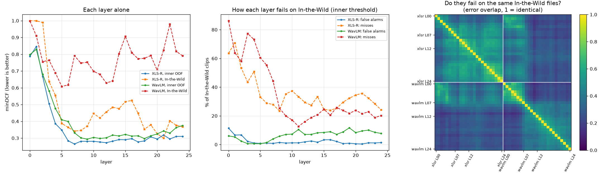

# Layer and backbone diversity: do they fail on different files?

Sat Oct 3, 2026. Exploration for v2 chunks V2-20 and V2-21 (`docs/prod-chunks.md`). Script `scripts/explore_layer_diversity.py`; outputs `outputs/v2/layer_diversity/` (`summary.json`, `noise.json`, the probe cache); figure below.

**Question (Nathan):**
- Would using more XLS-R layers help, since different layers might fail on different files?
- Does WavLM fail the opposite way to XLS-R?

## Method

**Probes**
- Every layer of XLS-R 300M (v3 embedding sets) and of WavLM Large (wl sets), 50 probes in all.
- Each probe uses the M1b recipe unchanged: StandardScaler, then class-balanced logistic regression (C = 1), then a Platt map on the pooled out-of-fold (OOF) scores.
- Training uses the five inner folds of `splits/nsa_folds_plus_asv19.csv`: 23,790 rows.
- In-the-Wild is scored by the full-inner fit: 2,000 real and 1,000 fake clips.

**What each readout is used for**
- **Outer holdout:** dropped before any fit, so this run never reads it.
- **In-the-Wild:** a readout only. It is never fit on and never used to choose.
- **Pairs:**
  - Every pair is an equal-weight rank blend.
  - The top 10 are ranked by inner OOF.
  - Four pairs were named in the script before it ran: L7 with XLS-R L12, XLS-R L20, WavLM L9 and WavLM L18.

**Other checks**
- Embedding manifests were checked for `decode_error` rows: there are none.
- **Errors** are counted at each probe's own inner-OOF min-cost threshold.
- **Noise test:** each real In-the-Wild clip gets a noise floor, the 10th-percentile 25 ms frame energy minus the 95th, in dB. The clips are then split into thirds.

**Reproduction:** XLS-R L7 reproduces the shipped M1b probe exactly, and WavLM L9 reproduces its report.

| Probe | Inner | ITW | ITW P_FA | ITW P_miss | Source |
|---|---|---|---|---|---|
| XLS-R L7 | 0.2649 | 0.342 | 0.8% | 27.9% | `models/m1_…_0521/meta.json` |
| WavLM L9 | 0.2936 | 0.752 | 7.05% | 20% | `docs/reports/2026-09-26_post-draft-heads.md` |

## Findings

### 1. XLS-R's top layers fail differently, and are better on wild audio

Single layers:

| Probe | Inner | ITW | ITW P_FA | ITW P_miss |
|---|---|---|---|---|
| XLS-R L7 (shipped) | 0.265 | 0.342 | 0.8% | 27.9% |
| XLS-R L20 | 0.294 | 0.327 | 0.55% | 34.5% |
| XLS-R L21 | 0.319 | **0.300** | 0.4% | 35.7% |

- Mid layers win inner CV.
- The top layers (18–21) win In-the-Wild, with the fewest false alarms of any probe.

**L7 + L20, a pair named before the run:**

| | Inner | ITW | ITW P_FA | ITW P_miss |
|---|---|---|---|---|
| L7 alone | 0.265 | 0.342 | 0.8% | 27.9% |
| L7 + L20 | **0.255** | **0.267** | 0.5% | 26.3% |

- It beats L7 alone on both inner and wild. This is the strongest lead in the run.
- For scale, the whole shipped fusion scores ITW 0.228.

### 2. WavLM fails the opposite way at every useful layer

From layer 8 up, WavLM:
- has false alarms of 6–12% on In-the-Wild, against about 1% for XLS-R
- catches 93–178 of XLS-R L7's 279 In-the-Wild misses
- brings 107–223 new false alarms

A false alarm here costs about 4.7 caught misses, because cost = 9.33·FA/2,000 + misses/1,000. So WavLM's catches do not pay for its false alarms.

**The trap.** Every top-10 pair by inner OOF is XLS-R L6/L7 with an upper WavLM layer:

| Ranking | Inner | ITW | ITW P_FA |
|---|---|---|---|
| Top-10 pairs by inner OOF | 0.218–0.233 | 0.34–0.42 | 2–3% |
| L7 alone | 0.265 | 0.342 | 0.8% |

Choosing on inner CV alone would pick a combination that is worse on real-world audio. Inner CV contains no wild real speech, so it cannot see WavLM's false alarms. This is a concrete case for V2-01's multi-population benchmark.

### 3. Background noise explains part of WavLM's false alarms

False-alarm rate on real In-the-Wild clips, split into thirds by noise floor. The bands are −65 to −37 dB, −37 to −30 dB, and −30 to −4 dB.

| Probe | Cleanest third | Middle | Noisiest third |
|---|---|---|---|
| XLS-R L7 | 0.75% | 0.30% | 1.35% |
| XLS-R L12 | 1.8% | 0.30% | 3.6% |
| WavLM L9 | 3.45% | 4.95% | **12.7%** |
| WavLM L18 | 4.5% | 7.1% | **14.8%** |

**Read:**
- Noise roughly triples WavLM's false alarms.
- Even its cleanest third is 4–5× XLS-R's rate.
- "Trust WavLM only on clean clips" would cut its false alarms, but not to XLS-R's level.

This supports the denoising hypothesis in `docs/prod-chunks.md` B.2 partly, not fully.

### 4. Error overlap

From the heatmap (right panel):
- **Neighbouring XLS-R layers:** about 0.6–0.7 Jaccard on In-the-Wild errors.
- **Mid vs top XLS-R layers:** lower.
- **Across backbones:** about 0.2–0.3.

**Read:**
- Adjacent layers are near-duplicates, which is why averaging layers 5–9 in v1 did little.
- The useful diversity is between distant layers and between backbones.

## Caveats

- **One wild set.** In-the-Wild is a single population (54 speakers), and v1 already used it to select the fusion rule. The L7 + L20 gain is a readout on one set, with no confidence interval.
- **No holdout reading yet.** The outer holdout is untouched, so it is still available for a pre-declared confirmation.
- **Rank against fold-model distributions.** Pair ranks are taken against each probe's inner-OOF distribution, while In-the-Wild is scored by the full-inner model. v1's fusion works the same way.
- **The noise proxy is crude.** Duration and speaking style also vary by clip.

## Next

1. **Pre-declare a confirmation of L7 + L20 vs L7.**
   - Read it once on the outer holdout, plus a second wild population once V2-30 adds one.
   - Add speaker-cluster bootstrap CIs.
2. **Then test the pair inside the v1 fusion.** In v1's rank blend, swap M1b L7 for L7 + L20, and compare against the shipped rule on the V2-01 benchmark.
3. **Test a gated WavLM.** Let WavLM raise a score only when the noise floor is below a set level. This belongs in V2-60's gated fusion, not a hand-set rule.
